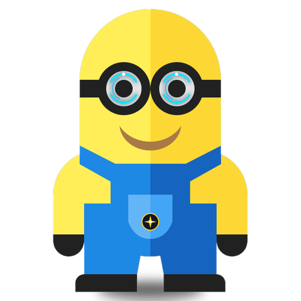

# 🍌 Minion AI — Your Personal Focus Companion

<div align="center">



### **On-Screen Productivity Intelligence & Sovereign Work-Journaling Assistant**

[](LICENSE)
[](https://www.python.org/)
[](https://www.microsoft.com/windows)
[](#-100-privacy--offline-sovereignty)
[](https://github.com/De-ORaCle/Minion-AI)

**Bello!** Minion AI is a playful yet deeply powerful desktop productivity companion built with Python and CustomTkinter. Featuring signature Minion styling (**Banana Yellow** & **Denim Blue**), Minion runs quietly on your Windows desktop, tracking active work episodes with sub-second accuracy, identifying cognitive flow states, and transforming raw computer usage into actionable insights and shareable standups—**with 100% local privacy and zero cloud tracking**.

[📥 Download Installer](https://github.com/De-ORaCle/Minion-AI/releases) • [🚀 Quick Start](#-quick-start-options) • [✨ Features](#-key-features) • [📖 Documentation](docs/DEPLOYMENT.md) • [🤖 Offline AI Setup](docs/OLLAMA_SETUP_GUIDE.md)

</div>

---

## 🧭 Choose Your Journey

<table>
<tr>
<td width="50%" valign="top">

### 👨‍💼 For Everyday Users (No Coding Required)
*You just want a fun, loyal focus companion on your PC.*

1. Go to the **[Latest GitHub Releases](https://github.com/De-ORaCle/Minion-AI/releases)** page.
2. Download **`Minion_Setup_v1.0.exe`** (Standard Windows Installer) or **`Minion_AI_v1.0_Portable.zip`** (No install needed).
3. Run the installer or unzip and double-click **`Minion.exe`**.
4. Minion starts tracking your active work immediately and sits quietly in your System Tray!

</td>
<td width="50%" valign="top">

### 👩‍💻 For Developers & Power Users
*You want to run from source, modify code, or contribute.*

1. Clone the repository:
   ```powershell
   git clone https://github.com/De-ORaCle/Minion-AI.git
   cd "Minion-AI"
   ```
2. Create and activate a virtual environment:
   ```powershell
   python -m venv .venv
   .\.venv\Scripts\Activate.ps1
   ```
3. Install dependencies and run:
   ```powershell
   pip install -r requirements.txt
   python app.py
   ```

</td>
</tr>
</table>

---

## 🎨 Design Philosophy & Signature Aesthetic

Minion AI adheres to an ergonomic, high-contrast light and dark palette inspired by Gru’s loyal crew:
- **Banana Yellow (`#FACC15` / `#B45309`)**: Highlights active focus states, velocity badges, and interactive controls.
- **Denim Blue (`#2563EB` / `#1D4ED8`)**: Minion overalls styling for action buttons, primary links, and user chat bubbles.
- **Crisp Canvas Surfaces (`#F8FAFC` / `#FFFFFF`)**: Modern, airy UI with 100% WCAG AAA/AA legibility contrast.
- **The Mascot Trio Stage**: Animated desktop stage featuring **Kevin** (the leader), **Stuart** (playful cyclops), and **Bob** (banana lover), with interactive comic click-to-talk banter!

---

## ✨ Key Features

### 1. 🍌 Minion Lounge & Mascot Stage (Primary GUI View)
- **Conversational Work Intelligence**: Interrogate your work history using natural English (*"What did I achieve this afternoon?"*, *"Where did my morning go?"*, *"How much time did I spend coding?"*).
- **Interactive Minion Crew**: Multi-frame animated trio with natural eye blinks, slap fights, and productivity coaching quotes tailored to your active task.
- **Temporal Query Engine**: Understands phrases like *today*, *yesterday*, *past 4 hours*, and cross-references SQLite logs to output mathematically precise answers.

### 2. ⏱️ Intelligent Activity Watcher & Deep Inference
- **Sub-Second Foreground Tracking**: Inspects focused windows, process executables, and tab titles with near-zero CPU footprint (<0.01%) using Windows `ctypes` and `psutil`.
- **Idle Detection Guard**: Senses mouse and keyboard inactivity (via Windows `GetLastInputInfo`) so stepping away never skews your focus score.
- **Micro-Action & Unsaved Edits Detection**: Detects file names (`chat_view.py`), language types (`Python`), and unsaved changes (`●`, `*`).
- **Cognitive Friction Alerts**: Warns when you are oscillating rapidly between documentation and source files, diagnosing stuck debugging loops.

### 3. ⚡ Work Sprints & Flow Analytics
- **Episode Clustering**: Aggregates continuous activities into 20–90 minute cohesive **Work Sprints**.
- **Velocity & Flow State Scoring**: Assigns dexterity metrics and focus efficiency ratios.
- **Milestones Timeline**: Generates chronological achievement checklists of what you progressed through.

### 4. 🧠 Work Memory & Projects Radar
- **Multi-Craft Deliverable Discovery**: Detects active deliverables across any craft (Word manuscripts, Figma boards, Excel financial models, academic PDF studies, or local dev web apps like `http://localhost:5176/`).
- **Tech Stack Radar**: Discovers workspaces and tech stacks automatically (Python, React JSX, CustomTkinter, SQLite).
- **Goal Alignment Radar**: Correlates daily actions against your short/long-term goals, keeping you accountable.

### 5. 📊 Visual Analytics & Reports
- **Donut Distribution Charts**: Visual category breakdowns (`Work / Coding`, `Learning / Research`, `Communication`, `Distraction`).
- **Top Application Bar Graphs**: Identifies which applications dominate your focus.
- **One-Click Export**: Export complete analytical telemetry to CSV and JSON formats anytime.

### 6. 📣 Standup & Share Generator
- Generates polished social updates and daily team standups ready for LinkedIn, X/Twitter, or Slack/Teams.
- Works 100% offline using deterministic intelligent templates or local Ollama LLMs.

---

## 🔒 100% Privacy & Offline Sovereignty

Your data belongs strictly to you. Unlike cloud tracking software:
- **Zero Cloud Uploads**: All activity logs and profiles stay inside a local SQLite database (`data/minion_productivity.db`).
- **Zero API Keys Required**: Minion uses optional local offline models via [Ollama](https://ollama.com/) (e.g. `llama3.2:3b`).
- **Automatic Privacy Sanitization**: Passwords, banking portals, Bitwarden, 1Password, and incognito sessions are masked automatically (`[Private / Confidential Activity]`).

---

## 🚀 Quick Start Options

### Option A: Running from Source (Developers)

```powershell
# 1. Clone the repository
git clone https://github.com/De-ORaCle/Minion-AI.git
cd "Minion-AI"

# 2. Setup virtual environment
python -m venv .venv
.\.venv\Scripts\Activate.ps1

# 3. Install requirements
pip install -r requirements.txt

# 4. Launch Minion
python app.py
```

### Option B: Building Executable & Portable Distribution

Minion includes automated packaging scripts that bundle Python and all assets into a standalone Windows executable:

```powershell
# Build standalone Minion.exe and portable ZIP package
python build_executable.py
```
*Outputs: `dist/Minion/Minion.exe` and `dist/Minion_AI_v1.0_Portable.zip`.*

```powershell
# Build single-file Windows setup wizard (.exe) using Inno Setup
python build_installer.py
```
*Output: `dist/Minion_Setup_v1.0.exe`.*

---

## 🤖 Offline AI Agent Setup (Ollama)

Minion seamlessly integrates with local offline LLMs running on your machine:

1. Install [Ollama](https://ollama.com/download) on Windows.
2. Pull the recommended model in PowerShell:
   ```powershell
   ollama pull llama3.2:3b
   ```
3. Minion will automatically detect the local engine on startup. If Ollama is not installed or offline, Minion gracefully falls back to deterministic rule-based algorithms with zero interruption!

See the full [Offline AI Setup Guide](docs/OLLAMA_SETUP_GUIDE.md) for lightweight models (`llama3.2:1b`, `qwen2.5:3b`).

---

## 🧪 Testing

To run the automated test suite covering database persistence, heuristic categorization, segmentation, and reporting:

```powershell
python -m unittest tests/test_core.py
```

---

## 📂 Project Structure

```
Minion-AI/
├── app.py                      # Application entry point & single-instance IPC
├── config.py                   # Design system tokens, intervals, fonts, colors
├── build_executable.py         # PyInstaller standalone bundler engine
├── build_installer.py          # Inno Setup Windows installer compiler
├── requirements.txt            # Python dependencies
├── assets/                     # Mascot sprites, icons, and Work Sans typography
├── core/                       # Core engine modules
│   ├── monitor.py              # Windows active window tracker & idle detector
│   ├── database.py             # SQLite WAL persistence engine
│   ├── single_instance.py      # Exclusive socket IPC guard
│   ├── deep_analyzer.py        # Micro-action delta & loop detection
│   ├── sprint_engine.py        # 20-90min work sprint episode clustering
│   ├── project_intelligence.py # Universal deliverable & local server discovery
│   ├── categorizer.py          # Multi-tier scored activity classifier
│   ├── reporter.py             # Lazy Matplotlib visualization engine
│   ├── share_generator.py      # Standup & social post generator
│   └── ai_agent.py             # Local Ollama client & conversational bridge
├── gui/                        # CustomTkinter graphical interface
│   ├── main_window.py          # Root window, sidebar, and lazy view loader
│   ├── tray_manager.py         # Windows System Tray daemon
│   └── views/                  # Modular view screens
│       ├── chat_view.py        # Minion Lounge & AI chat assistant
│       ├── minion_crew.py      # Interactive mascot stage (Kevin, Stuart, Bob)
│       ├── tracker_view.py     # Live activity watcher feed
│       ├── insights_view.py    # Work insights & deliverable intelligence
│       ├── context_view.py     # Work memory & tech stack radar
│       ├── reports_view.py     # Matplotlib focus charts
│       ├── segments_view.py    # Sprints and accomplishment milestones
│       ├── share_view.py       # Standup & share post generator
│       └── settings_view.py    # System preferences & Ollama lab
├── docs/                       # Public project documentation
│   ├── DEPLOYMENT.md           # Public release and deployment instructions
│   ├── OLLAMA_SETUP_GUIDE.md   # Local offline model installation guide
│   └── PROJECT_AIM.md          # Architectural rationale & engineering specs
└── tests/                      # Automated unit & integration tests
    └── test_core.py            # Comprehensive test suite
```

---

## 🤝 Contributing

Contributions, bug reports, and suggestions are welcome!
1. Fork the repository on GitHub.
2. Create a feature branch (`git checkout -b feature/amazing-feature`).
3. Commit your changes (`git commit -m 'Add amazing feature'`).
4. Push to your branch (`git push origin feature/amazing-feature`).
5. Open a Pull Request.

Please see [docs/DEPLOYMENT.md](docs/DEPLOYMENT.md) for maintainer guidelines and testing protocols.

---

## 📜 License

Distributed under the **MIT License**. See [`LICENSE`](LICENSE) for details.

---

## 👤 Author & Maintainer

- **Author**: Bukola Olapade ([@De-ORaCle](https://github.com/De-ORaCle))
- **Official Repository**: [https://github.com/De-ORaCle/Minion-AI](https://github.com/De-ORaCle/Minion-AI)
- **Community & Issues**: [GitHub Issues & Discussions](https://github.com/De-ORaCle/Minion-AI/issues)
